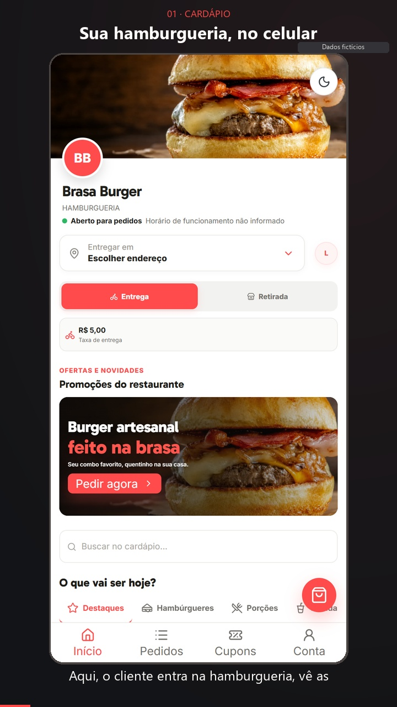

# Demonstração do delivery GastroNexa

[Assistir ou baixar o vídeo para WhatsApp](./GastroNexa-delivery-WhatsApp.mp4)

Vídeo vertical de aproximadamente 65 segundos, em 720 × 1280, com narração contínua em português e legendas. Mostra a interface real do GastroNexa: home da hamburgueria, cupom, escolha do produto, observação, carrinho, endereço, Pix, preparação, motoboy 3D percorrendo a rota no Google Maps e entrega concluída.

Brasa Burger, cliente, telefone, endereço, pedido, pagamento e posições GPS são dados fictícios. O mapa Google é real; o deslocamento e a confirmação do Pix são simulados. Nenhum pedido ou cobrança real foi criado. O vídeo foi gravado localmente com uma chave exclusiva, lida de um `.env` ignorado pelo Git. Nenhuma chave ou configuração de produção faz parte desta alteração.

## Correção do rastreamento

O JPEG publicado anteriormente não podia ser decodificado pelo navegador. A nova [imagem do motoboy](../../frontend/src/assets/tracking/courier-delivery-8dir.png) tem fundo transparente e oito vistas. O personagem acompanha o deslocamento, usa a direção correta nas rotas horizontais e mantém a posição intermediária quando chega uma atualização GPS antes do fim da animação. Quando o GPS não informa uma direção, ela é calculada entre as coordenadas recentes.

A rota de pedido entregue também foi incluída na autorização das páginas do cliente, seguindo a mesma proteção do acompanhamento. Isso corrige o redirecionamento repetido após confirmar o recebimento; a autorização dos dados continua no backend.

## Origem da imagem

Ferramenta: ImageGen integrada, edição da imagem original recuperada, com transparência.

Prompt utilizado:

> Edit the supplied 3D delivery courier sprite sheet for a production Google Maps marker. Preserve the exact same cute 3D courier wearing a white helmet, dark clothing, orange scooter and orange insulated delivery box. Preserve all eight existing views and their exact 4 columns by 2 rows grid placement. Remove only the white background, preserving white helmets and scooter highlights as opaque. Output actual transparent alpha, not a checkerboard drawn in pixels. Restore sharp smooth detail appropriate to a tiny map marker while keeping the same character, same motorcycle, same colors, pose and camera angles in every corresponding cell. No added labels, no text, no borders, no ground, no additional objects. Each of eight equal cells must contain one entire centered character and motorcycle with no clipping, consistent scale and generous transparent padding. Keep sheet aspect ratio 2:1. All backgrounds including gaps must be completely transparent.
